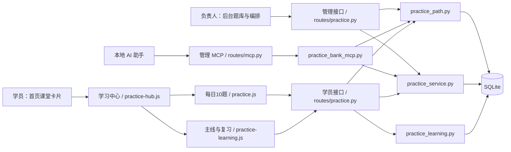

# AI宝儿问答课堂：课程说明与架构

本文描述当前的问答课堂。首页仍以普通 AI 问答为主，只用一张卡片进入课堂；课堂把七单元进阶主线放在首位，另提供每日 10 题和到期复习。三种练习共用母题库，但使用不同会话和结算逻辑。

| 学习方式 | 内容与结果 |
| --- | --- |
| 进阶主线 | 七个单元依次解锁，每单元三题；答错题进入复习安排，不计周榜积分 |
| 每日问答闯关 | 每日一组 10 题，按 3 题热身、4 题应用、3 题巩固展示；答对每题 10 分，当天最多 100 分；完成后可随机再练 10 题，不再加分 |
| 到期复习 | 每天最多三道到期错题，更新个人掌握状态，不计周榜积分 |

首期主线围绕一款**独立输入的培训产品**。产品名称和产品问题在课堂后台填写，不从“产品”板块自动读取资料，也没有单独的知识卡。产品事实与判断依据写在题目、解析和参考回复里。现阶段只有一条七单元主线；旧四单元产品短课已停止新建与发布，旧表和历史会话保留。

## 学员使用

1. 从首页课堂卡片进入学习中心。学习中心优先展示当前主线单元及已完成节点；每日 10 题、到期复习、闯关记录和团队周榜为次级入口。
2. 每题选择一个答案后立即看到解析和参考回复，再进入下一题。第三题作答后完成单元，答错不阻止解锁下一单元。短课作答不调用 Coze 判分。
3. 退出或刷新后，学习中心从服务端读取本人进度并恢复未完成会话。题目和选项顺序在创建会话时固定；未答题不返回推荐答案。
4. 错题按实际作答日安排：答错后次日出现；之后答对则隔 3 天再复习，在不同日期连续答对两次标为“已掌握”，再隔 7 天巩固。到期未轮到的题顺延。近七天学习记录来自已完成的主线单元或每日闯关。

## 课程梯度与后台编排

七个单元的位置、类型和默认难度定义在 `services/practice_path.py` 的 `SEED` 中。后台可修改单元标题和选题；当前界面不修改顺序、类型或难度。

| 顺序 | 单元 | 类型 | 难度 |
| --- | --- | --- | --- |
| 1 | 认识产品 | 产品知识 | 1 · 识别事实 |
| 2 | 配料与规格 | 产品知识 | 2 · 理解判断 |
| 3 | 判断客户需求 | 沟通方法 | 3 · 场景应用 |
| 4 | 使用方法 | 产品知识 | 3 · 场景应用 |
| 5 | 准确回答与核实 | 沟通方法 | 4 · 组织回答 |
| 6 | 客户常见提问 | 产品知识 | 4 · 组织回答 |
| 7 | 处理异议与后续跟进 | 沟通方法 | 5 · 综合应对 |

每题只考一个学习目标，包含题干、四个不同选项、唯一推荐答案、解析和一句可实际使用的参考回复。`difficulty_level` 是五级学习难度，`suggested_unit_id` 是已确认的课程单元；`batch_no` 只表示每日题库关卡号，不表示课程难度。同一母题可用于课程、每日闯关和每周主题。

后台组课流程：

1. 输入培训产品名称，建立固定七单元框架。
2. 在母题库（`stage_id=0`）逐题录入，或通过 MCP 建题。每单元选三道**不同**题，共需 21 道。题目可以保持“停用”，课程不依赖每日题库的启用状态。
3. 负责人核对事实、推荐答案、解析、学习目标、难度和建议单元。后台可先保存不足三题的单元；选题时能查看学习目标和解析。
4. 七个单元各选满三题后发布。发布检查要求题目属于母题库、未归档，有学习目标，且难度、建议单元与所在单元一致。

接受 MCP 的分级建议只更新题目的学习目标、难度和建议单元，**不会自动选入单元**。修订课程时后台编辑草稿，学员继续使用上次发布的版本；再次发布后新短课使用新版，已开始的短课保留自身快照。

## 架构

应用沿用 Flask、SQLite、浏览器身份验证和管理员验证。学员归属由服务端身份确定；主线、复习与每日闯关会话互相独立。`practice_common.py` 提供北京时间、事务、错误和请求标识校验。后台可在学习功能关闭时准备内容；学员接口由 `practice` 和 `practice_learning` 两个功能开关控制，后者默认关闭。

### 数据模型与版本

| 数据 | 表 | 作用 |
| --- | --- | --- |
| 母题 | `practice_quiz_questions` | 四选一题、答案、解析、学习目标、难度和建议单元；课程从 `stage_id=0` 选题 |
| 主线草稿 | `practice_learning_path_settings`、`practice_learning_path_units`、`practice_learning_path_questions` | 培训产品名称、七个单元及当前选题 |
| AI 编排建议 | `practice_learning_path_suggestions` | 待审核的学习目标、难度、单元建议及题目版本 |
| 已发布主线 | `practice_learning_path_publication` | 发布时保存单元与题目快照；草稿修改不影响学员版本 |
| 短课与复习 | `practice_learning_sessions`、`practice_learning_answers` | 本人会话快照、答题位置、选项及完成状态；`kind` 为 `path` 或 `review` |
| 掌握与学习日期 | `practice_learning_mastery`、`practice_learning_activity` | 错题到期日、答对次数和学习日期 |
| 每日闯关与积分 | `practice_quiz_sessions`、`practice_quiz_points` 等 | 独立的 10 题会话、积分与团队周榜 |

迁移 `202610230001` 增加发布快照表。此前已发布的主线在读取时仍可使用，首次修改前会保存原发布内容。旧 `practice_learning_courses`、`practice_learning_facts` 和 `practice_learning_unit_questions` 表不参与当前主线。

### 接口与权限

| 身份 | 入口 | 用途 |
| --- | --- | --- |
| 学员 | `GET /api/practice/learning/home`、`GET /api/practice/learning/path` | 到期复习、学习日期、已发布主线和本人下一单元/恢复位置 |
| 学员 | `POST /api/practice/learning/sessions`、`GET /api/practice/learning/sessions/<id>`、`POST /api/practice/learning/sessions/<id>/answer` 与 `/next` | 创建、恢复、作答和推进短课；`request_id` 防重复提交 |
| 学员 | `/api/practice/entry`、`/api/practice/sessions`、`/api/practice/scores` | 独立的每日闯关、记录和周榜 |
| 管理员 | `/api/admin/practice/learning/path` 及其 `/initialize`、`/units/<id>`、`/suggestions/<id>`、`/publish` | 建立主线、保存草稿、审核建议及发布 |
| 本地 AI | `POST /api/mcp/practice-bank` | 读出题规则、查重、上传题目和提交待审核分级建议 |

题库 MCP 使用独立 Bearer 令牌，复用后台题目校验与版本检查，**不能发布课程**。典型链路为：`practice_learning_guidelines` → `practice_learning_outline` → 搜索/读取题目 → `practice_create_question` 或 CSV 批量建题 → `practice_suggest_placement` → 后台审核、选题、发布。MCP CSV 中填写“学习目标”“难度等级”“建议单元ID”会被拒绝；空列会从导入内容移除，更新已有题时不会清空已审核分级。连接设置与工具参数见 [题库管理 MCP](./PRACTICE_BANK_MCP.md)。

## 验证与代码入口

- `python3 scripts/test_practice_path.py`：七单元梯度、发布快照、恢复、身份隔离、重复提交、旧版兼容与不加分。
- `python3 scripts/test_practice_bank_mcp.py`：MCP 鉴权、建题、建议、CSV 和转发；需安装 `requirements.txt`。
- `node scripts/test_practice_frontend.js`：学习中心、恢复入口、复习与前端状态。

课程代码入口为 `static/js/practice-hub.js`、`static/js/practice-learning.js`、`static/admin/practice-path.js`、`routes/practice.py`、`services/practice_path.py` 和 `services/practice_learning.py`。每日闯关与每周主题的规则见 [每日闯关说明](./CUSTOMER_PRACTICE.md)。
